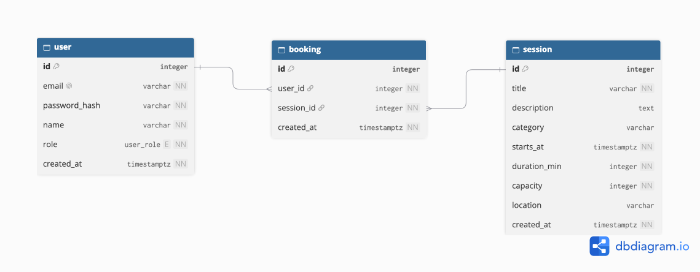

# Holdbooking – databaserapport

**Databaser 2 · EK Webudvikling, 2. semester · december 2026**
Rasmus Lindberg Knabe

Repository: *(link indsættes)*

---

<!--
SKRIVEVEJLEDNING (fjernes inden aflevering)
- Stikord i punktform → skrives om til brødtekst, når afsnittet står på dagsplanen.
- Mål: ca. 10 sider i alt. Sidetal i parentes ved hver overskrift er et cirka-budget.
- Figurer: læg billedet i img/ og skriv  + en kursiv figurtekst.
- Eksport: VS Code → højreklik → "Markdown PDF: Export (pdf)".
-->

## Indholdsfortegnelse

*(Genereres til sidst med "Markdown All in One: Create Table of Contents")*

---

## 1. Indledning *(½ side · skrives 7/12)*

- Projektet: holdbooking. Admin opretter hold (web), medlemmer booker og afmelder (mobil)
- Arkitektur kort: Next.js + React Native → NestJS REST API → PostgreSQL
- Rapportens formål og opbygning

## 2. Valg af database *(½–1 side · skrives 28/11)*

- Hvorfor relationel database (PostgreSQL) til booking:
  - Data er stærkt struktureret og har faste relationer
  - Integritet er kritisk: ingen overbooking og ingen dobbeltbooking → constraints og transaktioner (ACID)
- Hvorfor PostgreSQL frem for MySQL eller andre: *(udfyldes)*

## 3. Datamodel *(1–1½ side · skrives 29/11)*

*Figur 1: ER-diagram for holdbooking. Booking er en join-entitet mellem User og Session. Kombinationen (user_id, session_id) er unik, så et medlem ikke kan booke det samme hold to gange, og session.starts_at er indekseret for at gøre datofiltrering hurtig.*

**Entiteter**
- User: email unik, password gemmes kun som bcrypt-hash, rolle er enum (admin/member)
- Session: et hold med tidspunkt, varighed og kapacitet
- Booking: kobler en user og en session sammen og har sin egen `created_at`

**Relationer**
- User 1–n Booking og Session 1–n Booking giver tilsammen User n–m Session
- Hvorfor Booking er en rigtig entitet og ikke en ren join-tabel: den har egne data og egne endpoints (book og afmeld)

**Constraints, og hvorfor de ligger i databasen**
- NOT NULL på fremmednøglerne, så en booking aldrig kan mangle en ejer eller et hold
- UNIQUE på email og på (user_id, session_id). Databasen er sidste forsvar, også hvis backenden har en fejl.
- ON DELETE CASCADE: sletter man et hold, forsvinder dets bookinger. Alternativet RESTRICT er overvejet. *(begrund valget)*

**Normalisering**
- Ledige pladser gemmes ikke. De beregnes som capacity − COUNT(booking), fordi et gemt tal kan blive forkert, så der ikke er redundant data.
- Tabellerne er på 3NF: hvert felt afhænger kun af sin egen primærnøgle.
- Category er et simpelt felt og ikke en tabel. Det er en bevidst forenkling, og en tabel ville være en naturlig udvidelse.

**Datatyper**
- `timestamptz` i stedet for `timestamp`, så tidszonen er med

## 4. Seed-data *(¼ side · skrives 28/11)*

- Seed-script: `npm run seed`
- Antal rækker pr. entitet, og hvordan data er genereret (evt. med AI)
- Ekstra datasæt med ~10.000 hold til index-test (se afsnit 7)

## 5. Integration med backend *(½ side)*

- TypeORM: entities, repositories og relationer
- DTO'er og validering (`class-validator` + `ValidationPipe`)
- Parametriserede queries (se afsnit 8)

## 6. Transaktioner og samtidighed *(1 side · skrives 1/12)*

- Problemet: race condition af typen check-then-act. To medlemmer booker den sidste plads samtidig. *(tidslinje-figur)*
- En transaktion alene løser det ikke under READ COMMITTED
- Løsning: pessimistisk lås (`SELECT … FOR UPDATE`) på holdet, tæl, tjek kapacitet, opret, commit
- Alternativer: optimistisk lås (versionsfelt), SERIALIZABLE med retry
- Bevis: integrationstest med to samtidige bookinger, hvor kun én lykkes

## 7. Indexes og query-optimering *(¾ side · skrives 2/12)*

- Index på `session.starts_at` til filteret `?from=&to=`
- `EXPLAIN ANALYZE` før og efter med ~10.000 hold: Seq Scan → Index Scan *(figur eller kodeblok)*
- Den unikke index på (user_id, session_id) dækker også opslag på user_id (`GET /me/bookings`)
- Ulempe ved indexes: langsommere skrivning og mere plads

## 8. Sikkerhed *(1 side · skrives 3/12)*

- Hashing: bcrypt med salt, aldrig klartekst
- SQL injection: TypeORM bruger parametriserede queries *(eksempel på sårbar vs. sikker kode)*
- DB-roller: admin-konto (ejer af skemaet) og app-konto med minimale rettigheder (`GRANT SELECT, INSERT, UPDATE, DELETE`)
- Bevis: app-kontoen kan ikke køre `DROP TABLE`

## 9. Alternativt design: dokumentdatabase (MongoDB) *(1 side · skrives 4/12)*

- Dokumentmodel: users, sessions, bookings
- Embed eller reference for bookinger? *(begrund)*
- 3–4 eksempelqueries
- Hvordan håndteres kapacitet og dobbeltbooking uden fremmednøgler og join?

## 10. Alternativt design: grafdatabase (Neo4j) *(1 side · skrives 5/12)*

- Noder: `(:User)`, `(:Session)` · relation: `(:User)-[:BOOKED {createdAt}]->(:Session)`
- 3–4 Cypher-queries, inkl. "medlemmer der tog dette hold, tog også …"

## 11. Sammenligning *(¾ side · skrives 6/12)*

| | PostgreSQL | MongoDB | Neo4j |
|---|---|---|---|
| Dataintegritet | | | |
| Normalisering | | | |
| Transaktioner | | | |
| Komplekse queries | | | |
| Sikkerhed | | | |

## 12. Migreringsproces *(½ side · skrives 6/12)*

- Fra PostgreSQL til MongoDB: *(trin)*
- Fra PostgreSQL til Neo4j: *(trin)*
- Udfordringer: id'er, relationer og constraints, der skal flyttes ind i applikationen

## 13. Miljøer *(½ side · skrives 7/12)*

- Dev: docker-compose med Postgres (port 5433), `.env`, `synchronize` kun i dev
- Prod: ikke et krav til DB-afleveringen. Beskriv kort, hvordan prod er tænkt (VPS, Docker Compose, ingen `synchronize`, migrations), og at det kommer med Fullstack/DevEnv

## 14. Brug af AI *(¼ side · skrives 8/12)*

- Hvilke værktøjer, og til hvad (fx seed-data, ERD-kode, review)
- Hvad jeg selv har skrevet og kontrolleret

## 15. Konklusion *(¼ side · skrives 7/12)*

- 

## Litteratur

- 
